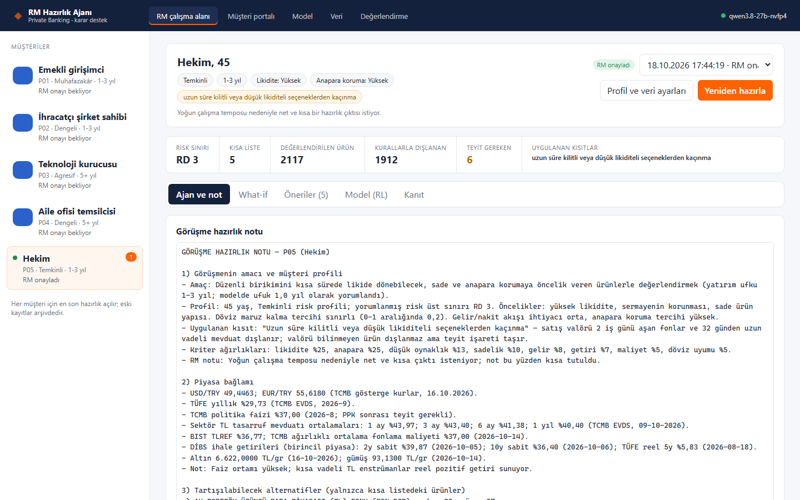
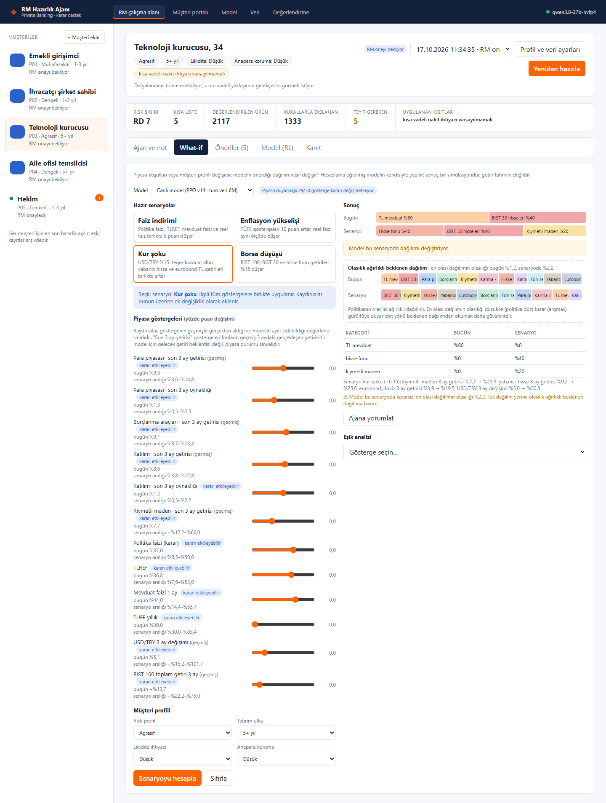
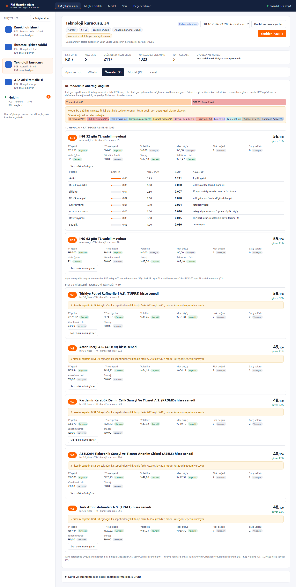
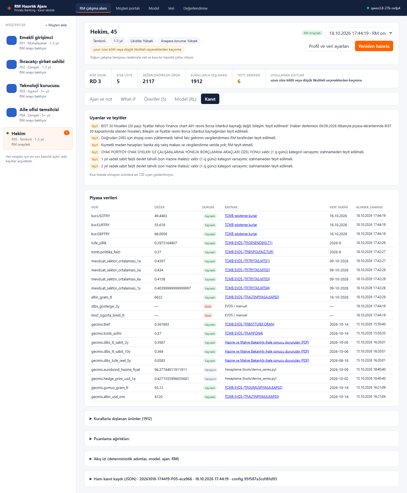
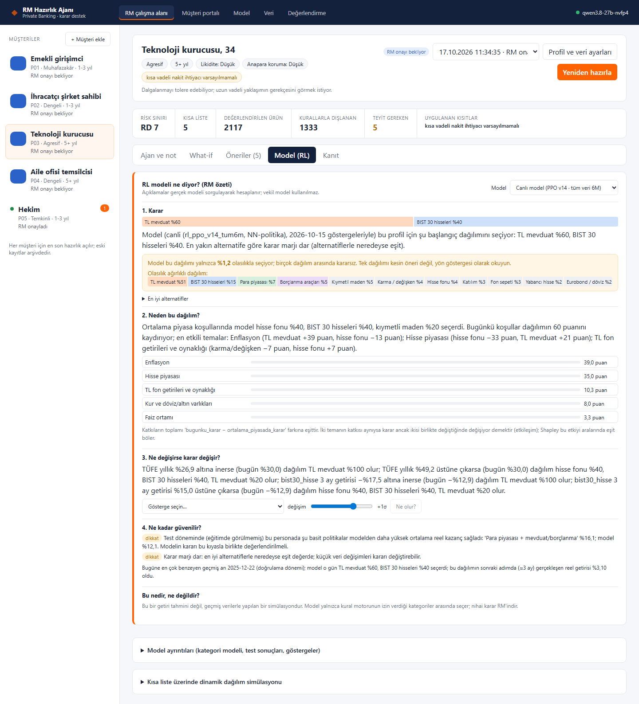
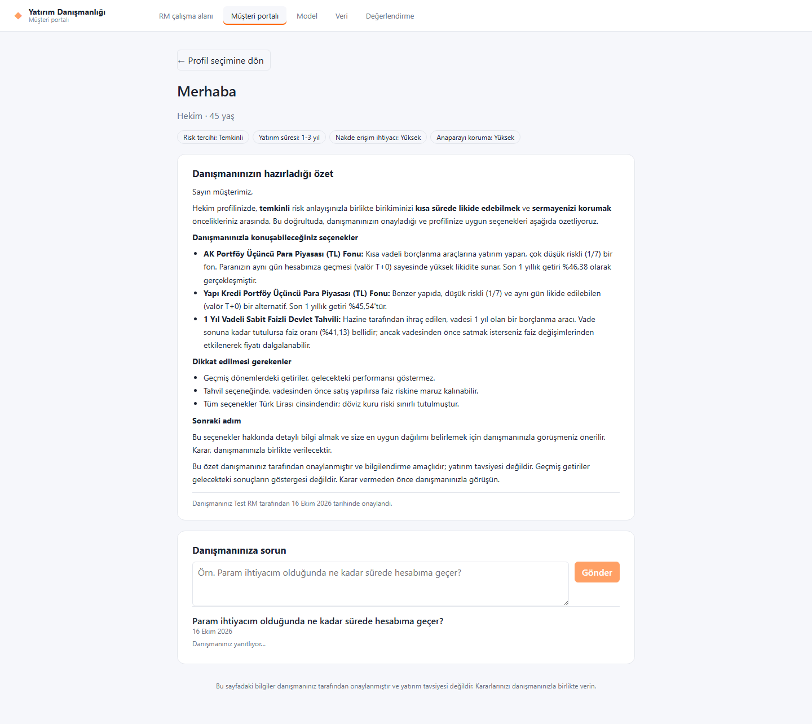
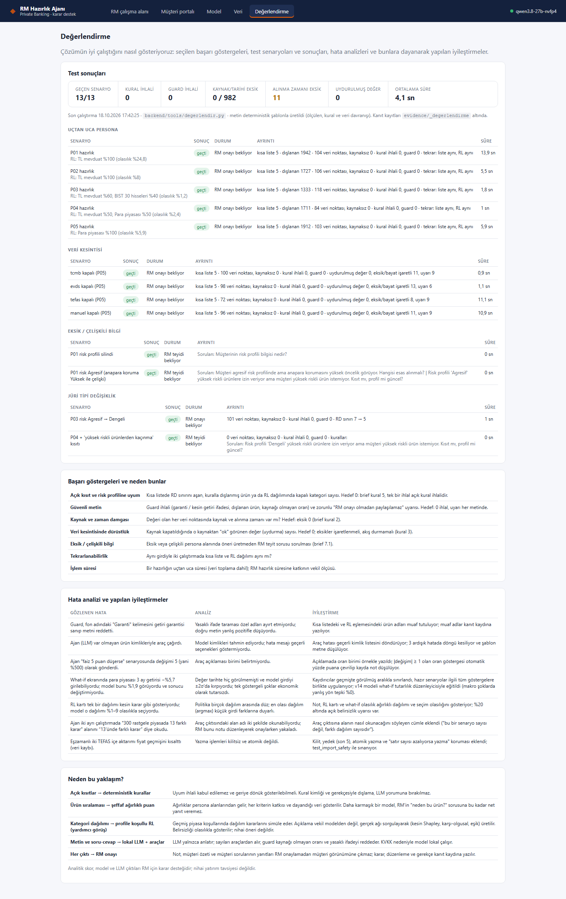
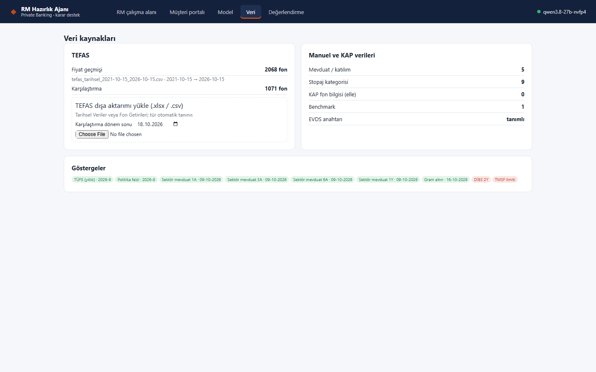

# RM Hazırlık Ajanı: Private Banking Yatırım Karar Destek

ING Hubs Türkiye **Agentic AI Hackathon** projesi. Private Banking RM'inin müşteri görüşmesine hazırlanmasını destekler:
- kamuya açık piyasa ve ürün verisini toplar,
- ürünleri persona profiline ve açık kısıtlara göre filtreleyip sıralar,
- her kararı kaynağı ve gerekçesiyle gösterir,
- RM için bir görüşme hazırlık notu üretir.

**Müşteriye hiçbir çıktı RM onayı olmadan gitmez. Karar RM'indir.**

Ayrıntılı teslim belgeleri [docs/teslim](docs/teslim/README.md) klasöründe:
- problem tanımı,
- analitik çözüm,
- çözüm tasarımı,
- test ve öğrenimler,
- kanıt kaydı örneği,
- sunum ve demo senaryosu.

| | |
|---|---|
|  |  |

## İçindekiler

1. [Problem tanımı ve çözüm yaklaşımı](#1-problem-tanımı-ve-çözüm-yaklaşımı)
2. [Veri kaynakları ve temel sinyaller](#2-veri-kaynakları-ve-temel-sinyaller)
3. [Karşılaştırma, sıralama ve karar mantığı](#3-karşılaştırma-sıralama-ve-karar-mantığı)
4. [Çözüm mimarisi ve veri akışı](#4-çözüm-mimarisi-ve-veri-akışı)
5. [AI / agentic bileşenler ve görev akışı](#5-ai--agentic-bileşenler-ve-görev-akışı)
6. [Varsayımlar, belirsizlikler ve insan onay noktaları](#6-varsayımlar-belirsizlikler-ve-insan-onay-noktaları)
7. [Test yaklaşımı, sonuçlar, hata analizi ve iyileştirmeler](#7-test-yaklaşımı-sonuçlar-hata-analizi-ve-iyileştirmeler)
8. [İzlenebilirlik: kaynak, zaman damgası, karar gerekçesi](#8-i̇zlenebilirlik-kaynak-zaman-damgası-karar-gerekçesi)
9. [Ekran görüntüleri](#9-ekran-görüntüleri)
10. [Kurulum ve çalıştırma](#10-kurulum-ve-çalıştırma)

---

## 1. Problem tanımı ve çözüm yaklaşımı

**Problem.** RM görüşmeye hazırlanırken faiz, fon getirisi, kur, vergi ve ürün koşulu bilgisini farklı kaynaklardan elle topluyor. 2.100'ü aşkın ürünü müşterinin risk profili, vadesi, likiditesi ve kısıtlarıyla tek tek karşılaştırıyor. Önerinin hangi veriye ve varsayıma dayandığını sonradan gösteremiyor.

**Hedef ve beklenen iş etkisi.**

| Hedef | Ölçü | Sonuç |
|---|---|---|
| Hazırlığı saniyelere indirmek | Uçtan uca hazırlık süresi | Ortalama 5,3 sn (önbellek boşken ~30 sn) |
| Uyum riskini sıfırlamak | Kısa listede açık kısıta veya risk profiline aykırı ürün | 0 |
| Her değeri kaynağıyla göstermek | Kaynağı veya veri tarihi eksik veri noktası | 0 / 1.079 |

**Yaklaşım:** deterministik çekirdek, LLM kenarda, RM her kapıda.
- **Kod garanti eder:** uyum kuralları, veri ve skor.
- **Lokal LLM ajanı anlatır:** sayıları araçlardan alır.
- **Pekiştirmeli öğrenme modeli yardımcı görüş verir:** kategori dağılımı ve what-if senaryoları.
- **RM karar verir:** her çıktı RM onayından geçer.

Ayrıntı: [docs/teslim/01_problem_tanimi.md](docs/teslim/01_problem_tanimi.md).

## 2. Veri kaynakları ve temel sinyaller

Tüm piyasa ve ürün verisi bir **veri tabanında** (SQLAlchemy; varsayılan SQLite, `DATABASE_URL` ile değiştirilebilir) tutulur. Elle düzenlenen veri dosyası yoktur.
- Veri yalnızca **otomatik toplayıcılarla** ([backend/app/collectors](backend/app/collectors)) ya da TEFAS dışa aktarım **yüklemesiyle** girer.
- Her satır kaynağını, URL'sini, kaynaktaki veri tarihini, alınma zamanını ve onu yazan **çekim** kaydını taşır.
- Her toplama çalışması `cekim` tablosuna yazılır: kaynak, yöntem, zaman, durum, satır, hata.
- Arayüzde **Veri** sayfası her toplayıcının son çekimini gösterir; toplama oradan da başlatılabilir.

| Kaynak | Ne alınıyor | Toplayıcı |
|---|---|---|
| TCMB `today.xml` | USD, EUR, GBP gösterge kurları | Her hazırlıkta canlı; başarısızsa son başarılı çekim "bayat" etiketiyle |
| TCMB EVDS (resmi API) | Kur, altın, gümüş, BIST 100, TLREF, fonlama maliyeti, sektör mevduat faizleri, eurobond, TÜFE serileri (2021 →) | `evds_seriler` (`EVDS_API_KEY` gerekli); anlık göstergeler her hazırlıkta canlı |
| TCMB politika faizi sayfası | Güncel politika faizi ve karar tarihçesi | `tcmb_politika` |
| Hazine ve Maliye Bakanlığı | DİBS ihale sonuçları (resmi PDF'ler; 2y, 10y, TÜFE'ye endeksli) | `hazine_dibs` |
| KAP fon sayfaları | Resmi risk değeri, yönetim ücreti, giriş/çıkış komisyonu, ISIN, valör, nitelikli yatırımcı ibaresi | `kap_fon` (kademeli: en eski kayıt önce, istekler arası bekleme) |
| ING | Mevduat hesaplayıcısı (TL ve döviz oranları, mevduat stopajı), fon vergilendirme tablosu, platformdaki fonlar | `ing_mevduat`, `ing_stopaj`, `ing_fonlar` |
| Yahoo Finance | BIST 30 hisseleri ve endeksler (resmi kaynak değil; notta teyit maddesi) | `bist` |
| Hesaplama | Eurobond fiyat vekili, vadeli kur primi, BIST 100 benchmark | `turetilmis` (istek atmaz; "varsayım" etiketli) |
| TEFAS | Fon fiyat geçmişi (2.068 fon), Fon Getirileri (ikinci kaynak) | **Yükleme:** uygulama TEFAS'a istek atmaz; dışa aktarımlar Veri sayfasından yüklenir. Mevcut geçmiş sitenin "Excel'e Aktar" çıktıları ve kullanıcı talimatıyla yazılmış tarayıcı otomasyonu (`tefascrawl`) ile alındı; kullanım koşulları notu: [veri_kaynaklari.md](docs/veri_kaynaklari.md). |

**Müşteri sinyalleri:**
- risk profili,
- yatırım ufku,
- likidite ihtiyacı,
- gelir / nakit akışı ihtiyacı,
- anapara koruma tercihi,
- döviz maruziyeti tercihi,
- yatırım amacı ve öncelikler,
- açık kısıtlar.

**Ürün sinyalleri:**
- 1 yıllık ve 3 aylık getiri, reel getiri,
- yıllık oynaklık, en büyük düşüş,
- risk değeri (RD 1–7),
- satış valörü ve vade,
- yönetim ücreti ve komisyon,
- stopaj,
- para birimi,
- fon büyüklüğü ve yatırımcı sayısı,
- benchmark farkı.

**Çapraz kontroller:**
- TEFAS fiyat geçmişinden hesaplanan getiri, Fon Getirileri dışa aktarımıyla karşılaştırılır.
- Banka mevduat oranları TCMB sektör ortalamasıyla karşılaştırılır.
- Resmi RD, oynaklıktan tahmin edilen RD ile karşılaştırılır.

Tam kaynak listesi: [docs/veri_kaynaklari.md](docs/veri_kaynaklari.md).

## 3. Karşılaştırma, sıralama ve karar mantığı

1. **Uygunluk (deterministik kurallar).**
   - Risk profili RD üst sınırına çevrilir: Muhafazakâr 2, Temkinli 3, Dengeli 5, Agresif 7.
   - Açık kısıtlar 23 kurallık [kısıt kataloğuna](backend/config/constraint_rules.json) eşlenir. Örnekler: yüksek risk yasağı, likidite kilidi, döviz artırmama, yoğunlaşma.
   - Her dışlama kural kimliği ve gerekçesiyle kaydedilir.
2. **Sıralama (şeffaf ağırlıklı puan).**
   - 8 kriter: getiri, düşük oynaklık, likidite, düşük maliyet, gelir üretimi, anapara koruma, döviz uyumu, sadelik.
   - Kriterler ürün evreni içinde 0–1'e normalize edilir.
   - Ağırlıklar persona alanlarından türetilir. Örneğin likidite ihtiyacı "Yüksek" ise likidite ağırlığı yükselir, "yüksek likidite" önceliği +0,5 ekler.
   - Verisi olmayan kriter skora girmez. Güven skoru, verinin kalitesine göre düşer.
3. **Kısa liste:** 5 ürün, kategori başına en fazla 2. Listeye girmeyen her uygun ürün için "neden listede değil" gerekçesi yazılır.
4. **Kategori dağılımı (yardımcı görüş).**
   - Profile koşullu bir NN-PPO pekiştirmeli öğrenme modeli kullanılır: 2021–2026 verisi, 30 gecikmeli piyasa göstergesi, profil kısıtları maske olarak uygulanır.
   - Bugünkü koşullarda kategori dağılımı önerir.
   - Açıklama gerçek ağı sorgulayarak üretilir: kesin Shapley, karşı-olgusal, eşik, benzer geçmiş dönemler.
   - Test döneminde model basit kuralı yalnızca iki personada geçtiği için nihai öneri değil, yardımcı görüş olarak konumlandırıldı.

**Neden bu yaklaşım?**
- Uyum ihlali kabul edilemez, bu yüzden kural.
- RM'in "neden bu ürün, neden şu değil?" sorusuna kriter düzeyinde yanıt verilebilmeli, bu yüzden şeffaf puan.
- Etiketli "doğru öneri" verisi olmadığı için öğrenen bir sıralayıcı açıklanabilirliği feda ederdi.

Ayrıntı: [docs/teslim/02_analitik_cozum.md](docs/teslim/02_analitik_cozum.md), RL: [docs/rl.md](docs/rl.md).

## 4. Çözüm mimarisi ve veri akışı

```
Persona (P01–P05, jüri değişiklikleri)
   │
   ▼
1 persona_yorumlama   [kod]   alanlar → risk seviyesi, RD sınırı, ufuk, kurallar
   │                          eksik / çelişkili / eşleşmeyen kısıt? ──► RM TEYİT SORUSU (akış durur)  ◄── RM
   ▼
2 veri_toplama        [kod]   TCMB · EVDS · TEFAS · KAP · Hazine · ING
   │                          her değer: kaynak · URL · veri tarihi · alınma zamanı · durum
   ▼
3 uygunluk_kurallari  [kod]   RD sınırı + 23 kısıt kuralı → dışlama (kural id + gerekçe)
   ▼
4 puanlama_secim      [kod]   8 kriter, persona kaynaklı ağırlıklar, güven skoru → kısa liste
   ▼
5 rl_kategori_modeli  [rl]    NN-PPO v14: dağılım + seçim olasılığı + olasılık ağırlıklı dağılım
   ▼
6 metin_taslagi       [llm]   lokal Qwen3.8-27B ajanı, araçlarla (kapalıysa deterministik şablon)
   ▼
7 metin_guard         [kod]   yasaklı ifade · dışlanan ürün · kaynaksız oran · zorunlu ibare
   ▼
8 RM onayı            [rm]    onay / düzenleyerek onay / red + gerekçe ──► kanıt kaydı (JSON)
   ▼
9 müşteri görünümü    [rm]    yalnızca RM'in ayrıca onayladığı özet ve yanıtlar
```

**Bileşenler:**

| Bileşen | Sorumluluk |
|---|---|
| Backend: FastAPI ([backend/app](backend/app)) | Akış, kurallar, puanlama, kanıt kaydı, API. Derlenmiş arayüzü aynı porttan sunar. |
| Frontend: React + TypeScript ([frontend/src](frontend/src)) | RM çalışma alanı, müşteri portalı, model, veri ve değerlendirme sayfaları |

Ayrıntı: [docs/teslim/03_cozum_tasarimi.md](docs/teslim/03_cozum_tasarimi.md).

## 5. AI / agentic bileşenler ve görev akışı

| Bileşen | Görev | Sınırı |
|---|---|---|
| **Hazırlık ajanı.** Lokal LLM: Qwen3.8-27B, vLLM; KVKK gereği veri dışarı çıkmaz. | Görüşme notunu yazar, RM'in sorularını yanıtlar | Sayıları araçlardan alır. En fazla 6 araç adımı; 3 ardışık hatada şablona düşer. |
| **Araçlar** | `profil_ozeti`, `kisa_liste`, `urun_detay`, `dislanan_ozeti`, `piyasa_baglami`, `teyit_listesi`, `musteri_sorulari`, `rl_karar`, `rl_neden` (Shapley), `rl_ne_olursa` (what-if), `rl_esik`, `rl_benzer_donemler`, `rl_guvenilirlik` | Hepsi deterministik kod ya da gerçek RL ağı |
| **Guard** | Her metni denetler: garanti dili, dışlanan ürün, araç çıktısında geçmeyen yüzde, zorunlu uyarı ibaresi | İhlalde ajan düzeltme turuna girer; olmazsa şablon metin |
| **Müşteri özeti ve yanıt ajanı** | RM onaylı paketten sade bir müşteri özeti ve soru yanıtı taslağı yazar | Kısıtlı araçlar. Yayın ancak RM onayıyla. |
| **RL modeli** | Kategori dağılımı ve what-if | Yardımcı görüş. Olasılığı düşükse arayüz ve not açıkça uyarır. |

**Görev akışı:**
1. RM "Hazırlık üret" der.
2. Deterministik akış çalışır.
3. Ajan araçlarla notu yazar.
4. Guard denetler.
5. RM notu okur, ajana soru sorabilir (araç izi görünür), what-if çalıştırır.
6. RM onaylar, düzenleyerek onaylar veya reddeder.
7. İsterse müşteri özetini hazırlatıp ayrıca onaylar.

Ayrıntı: [docs/ajan.md](docs/ajan.md).

## 6. Varsayımlar, belirsizlikler ve insan onay noktaları

**Varsayımlar.** Tüm eşik ve ağırlıklar gerekçeleriyle iki dosyada tutulur: [decision_config.json](backend/config/decision_config.json) ve [constraint_rules.json](backend/config/constraint_rules.json). Her kanıt kaydı bu dosyaların hash'ini taşır. Örnekler:
- Risk profili → RD eşlemesi.
- Bilinmeyen valör için kategori varsayımı, "izahnameden teyit" notuyla.
- Resmi RD yoksa oynaklıktan SPK bandıyla tahmin, "varsayım" etiketiyle.
- Mevduat kademesi: 1 mn TL.

**Belirsizlik yönetimi:**
- Veri çekilemezse değer uydurulmaz; alan "eksik" işaretlenir ve skora katılmaz.
- Önbellekten gelen veri "bayat" etiketi alır.
- Stopaj kaynakta yoksa getiri brüt gösterilir ve RM'e teyit notu düşer.
- Güven skoru %70'in altındaysa vurgulanır.
- RL modeli seçtiği dağılımı %20'nin altında olasılıkla seçiyorsa "kararsız" uyarısı verilir ve olasılık ağırlıklı dağılım gösterilir.
- What-if kaydırıcıları geçmişte görülmüş değerlerle sınırlıdır.

**İnsan onay noktaları:**
1. **Teyit.** Eksik, çelişkili veya tanınmayan persona bilgisi ya da eşleşmeyen kısıt varsa öneri üretilmez; RM soruyu yanıtlar.
2. **Not onayı.** Taslak not, RM onayı olmadan kesinleşmez. RM düzenleyebilir; düzenlenmiş metin ve gerekçe saklanır.
3. **Müşteri görünümü.** Müşteri özeti ve her soru yanıtı ayrı RM onayı ister. Müşteri sorusu doğrudan yanıtlanmaz, RM kuyruğuna düşer. RM onaylı bir yanıtı geri çekebilir.

## 7. Test yaklaşımı, sonuçlar, hata analizi ve iyileştirmeler

**Başarı göstergeleri** brief kurallarından seçildi: ortalama bir kalite skoru yerine sıfır tolerans ölçüleri. Bunlar kural ihlali, guard ihlali, kaynağı/tarihi eksik veri, uydurulmuş değer, eksik bilgide soru sorulması, tekrarlanabilirlik ve süre.

**Değerlendirme takımı** ([tools/degerlendir.py](backend/tools/degerlendir.py)) **14/14 senaryo** geçti:

| Senaryo grubu | Sonuç |
|---|---|
| 5 persona uçtan uca, her biri iki kez | 0 kural ihlali, 0 guard ihlali; tekrarlanabilir |
| 5 veri kesintisi (TCMB, EVDS, TEFAS, ING, KAP) | Akış tamamlandı, 0 uydurulmuş değer, eksikler işaretlendi |
| Eksik / çelişkili bilgi | Öneri üretilmedi, RM teyit sorusu soruldu |
| Jüri tipi değişiklikler (risk profili, yeni kısıt) | Liste yeni sınıra uydu ya da çelişki RM'e soruldu |

Sonuçlar arayüzde de görünür: **Değerlendirme** sayfası. Ayrıca 14 dosyada 145 birim/entegrasyon testi var (`pytest`).

**RL modeli (dürüst sonuç).**
- What-if makro şoklarında yanlış yön tepki oranı %0.
- Son 3 aylık testte model basit kuralı P01 ve P02'de geçti; P03–P05'te ve görülmemiş profillerde geçemedi.
- Bu yüzden RL yardımcı görüş olarak konumlandırıldı.

**Hata analizi → iyileştirme.** 10 vaka belgelendi; örnekler:

| Hata | İyileştirme |
|---|---|
| Guard fon adındaki "Garanti" kelimesini getiri vaadi sandı | Ürün adları muaf tutuluyor, muafiyet kayda yazılıyor |
| Ajan "5 puan" faiz indirimini 5 (%500) olarak gönderdi | Araçta birim örneği ve otomatik çevirme |
| What-if'te hiç görülmemiş bir değer (−%5,7) girilebiliyordu | Geçmiş aralığa sınır, tutarlı senaryolar, what-if tutarlılığıyla eğitilmiş model (v14) |
| RL tek dağılımı kesin karar gibi gösteriyordu (olasılık %1–25) | Olasılık ağırlıklı dağılım ve belirsizlik uyarısı |
| Müşteri yanıtında kaynaksız "1–2 iş günü" süresi | Ajan önce araç çağırmak zorunda; RM yanıtı geri çekebiliyor |
| Değerlendirme, KAP ve ING verisinde alınma zamanı eksikliği buldu | Gerçek çekim zamanları korunuyor, elle ölçüme zaman uydurulmuyor |

Tüm liste: [docs/teslim/04_test_ve_ogrenimler.md](docs/teslim/04_test_ve_ogrenimler.md).

## 8. İzlenebilirlik: kaynak, zaman damgası, karar gerekçesi

- **Veri tabanında her satır** kaynağını, URL'sini, veri tarihini, alınma zamanını ve onu yazan **çekim** kaydını taşır; çekim kaydı hangi toplayıcının ne zaman, hangi sonuçla çalıştığını gösterir ([docs/veri_tabani.md](docs/veri_tabani.md)).
- **Her veri noktası** `kaynak · URL · veri tarihi · alınma zamanı · durum` olarak taşınır. Durum kaynaklı, bayat, eksik, çelişkili veya varsayım olabilir. Arayüzde her değerin yanında gösterilir.
- **Her dışlama** kural kimliği ve gerekçesiyle kaydedilir; örneğin `R_RISK_PROFILI`: "Risk değeri RD 5, profil sınırı RD 3".
- **Her sıralama** kriter bazında katkı dökümüyle kaydedilir: ağırlık, normalize skor, katkı, dayanak. Ağırlığın hangi persona alanından geldiği de yazılır.
- **Her çalıştırma** bir kanıt kaydına (JSON) yazılır. Kayıt şunları içerir:
  - persona ve RM teyitleri, kapalı kaynaklar,
  - tüm veriler, kurallar, skorlar, RL çıktısı,
  - ajanın araç izi (araç, argüman, süre, token),
  - guard sonucu, taslak ve düzenlenmiş metin,
  - RM kararı (kim, ne zaman, gerekçe),
  - adım adım akış izi (aktör ve süre),
  - varsayım dosyalarının hash'i.
- **Örnek:** RM onaylı P05 kaydı [docs/teslim/05_kanit_ornegi.md](docs/teslim/05_kanit_ornegi.md) ve tam JSON [docs/teslim/kanit_ornegi.json](docs/teslim/kanit_ornegi.json).

## 9. Ekran görüntüleri

| Ekran | |
|---|---|
| **RM çalışma alanı:** görüşme hazırlık notu (lokal LLM ajanı), kısıtlar, teyit sayısı |  |
| **Öneriler:** kısa liste, kaynak etiketli göstergeler, kriter bazında skor dökümü |  |
| **Kanıt:** teyit uyarıları, kaynak / veri tarihi / alınma zamanı, dışlananlar, akış izi |  |
| **Model (RL):** karar, seçim olasılığı, olasılık ağırlıklı dağılım, Shapley temaları |  |
| **What-if:** "Kur şoku" tutarlı senaryosu, belirsizlik uyarısı |  |
| **Müşteri portalı:** yalnızca RM onaylı özet ve yanıtlar |  |
| **Değerlendirme:** test sonuçları, başarı göstergeleri, hata analizi |  |
| **Veri kaynakları:** TEFAS yükleme, gösterge durumu |  |

## 10. Kurulum ve çalıştırma

**Gereksinimler:**
- Python 3.11+
- Node 20+
- [Git LFS](https://git-lfs.com): modeller ve TEFAS fiyat geçmişi LFS ile.
- İsteğe bağlı: LLM ajanı için NVIDIA GPU'lu bir makinede vLLM.

```bash
git lfs install
```

```bash
git clone https://github.com/xdebron/inghackathon.git
```

**Backend:**

```bash
cd backend
python -m venv .venv
.venv/Scripts/python -m pip install -r requirements.txt   # Linux/macOS: .venv/bin/python
```

**Veri tabanı.** Repodaki tohumdan (`backend/data/seed/veri_tohum.db.gz`, Git LFS) kurulur:

```bash
cd backend
.venv/Scripts/python tools/veri_kur.py
```

Güncel veriyle yenilemek için toplayıcılar çalıştırılır (ya da arayüzde **Veri → Hepsini topla**):

```bash
cd backend
.venv/Scripts/python tools/veri_topla.py
```

`tools/veri_topla.py --liste` her toplayıcının son çalıştırmasını gösterir. Yalnızca birini çalıştırmak için adını verin, ör. `tools/veri_topla.py ing_mevduat`.

**Frontend** (derlenir; backend aynı porttan sunar):

```bash
cd frontend
npm install
npm run build
```

**Çalıştırma:**

```bash
cd backend
.venv/Scripts/python -m uvicorn app.main:app --port 8010
```

Tarayıcıda `http://localhost:8010` açın. Dışarıya açmak için örneğin `cloudflared tunnel --url http://localhost:8010` kullanılabilir.

**EVDS anahtarı (isteğe bağlı).** `backend/.env` dosyasına `EVDS_API_KEY=...` yazın; bu dosya git'e girmez. Anahtar yoksa EVDS göstergeleri son başarılı çekimden "bayat" etiketiyle ya da manuel kaynaktan gelir.

**Lokal LLM (isteğe bağlı).** Qwen3.8-27B-NVFP4, WSL'de vLLM ile `http://127.0.0.1:8001/v1` adresinde.

```bash
powershell -ExecutionPolicy Bypass -File scripts\vllm_ac.ps1
```

- İlk açılış ~10 dk sürebilir.
- Kapatmak için `scripts\vllm_kapat.ps1`.
- LLM kapalıyken sistem uçtan uca çalışır; not deterministik şablonla üretilir. Arayüzün sağ üstü LLM durumunu gösterir.

**Testler ve değerlendirme takımı:**

```bash
cd backend
.venv/Scripts/python -m pytest -q
```

```bash
cd backend
.venv/Scripts/python tools/degerlendir.py
```

**Veri güncelleme.** Otomatik kaynaklar `tools/veri_topla.py` ya da **Veri → Hepsini topla** ile güncellenir. TEFAS fiyat geçmişi tefas.gov.tr → Tarihsel Veriler → **Excel'e Aktar** ile indirilip **Veri** sayfasından yüklenir. Repodaki tohumu güncellemek için `tools/veri_tohum.py`.

**Jüri challenge'ı.** RM çalışma alanında **Profil ve veri ayarları**'ndan:
- persona alanları ve açık kısıtlar değiştirilebilir,
- "Veri kesintisi simülasyonu" ile bir kaynak kapatılabilir,
- **What-if** sekmesinde piyasa senaryosu uygulanabilir.

Her değişiklik yeni bir kanıt kaydı oluşturur. Hazır hamleler: [docs/teslim/06_demo_senaryosu.md](docs/teslim/06_demo_senaryosu.md).
